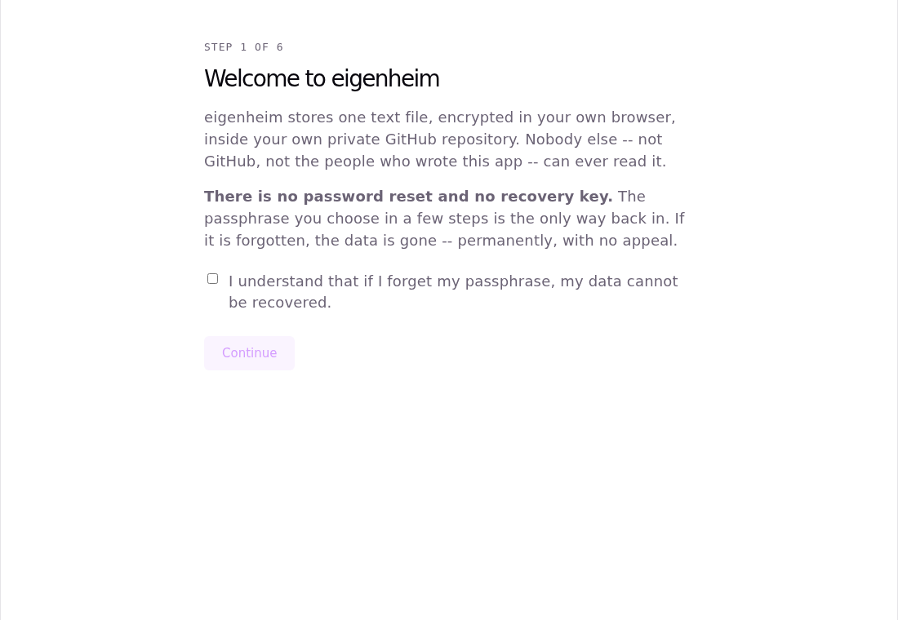
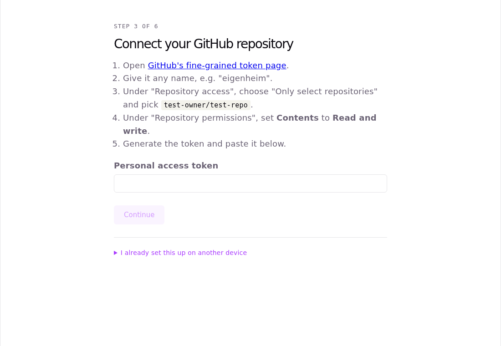
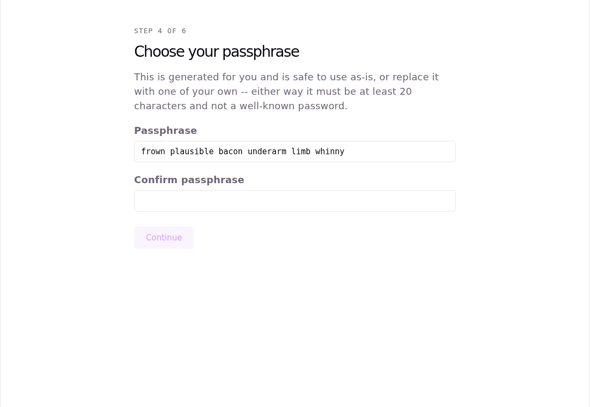
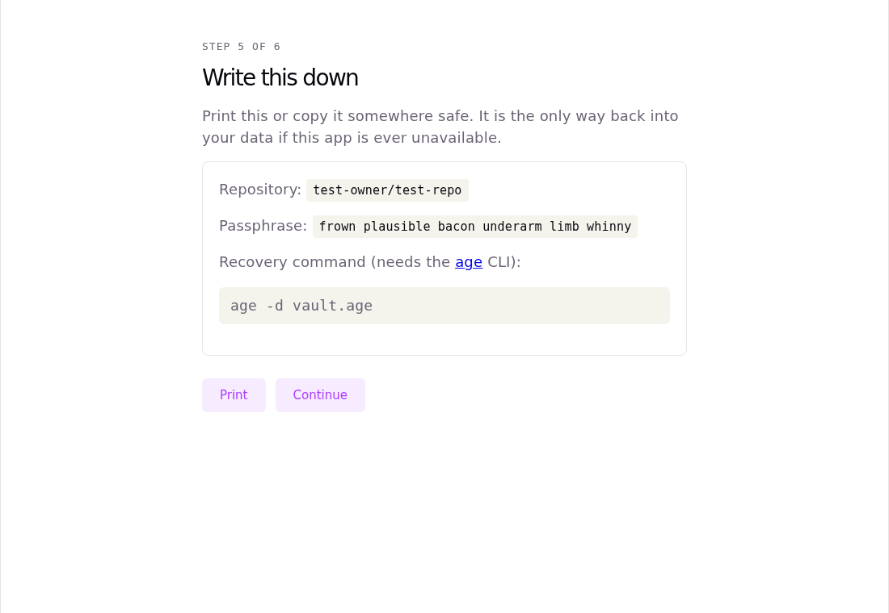
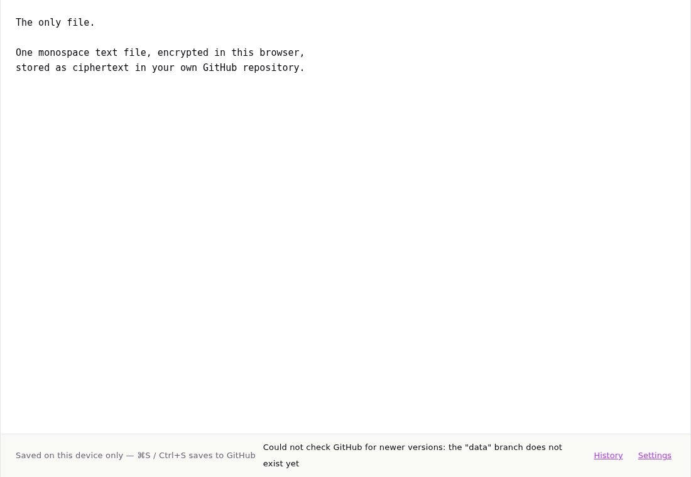
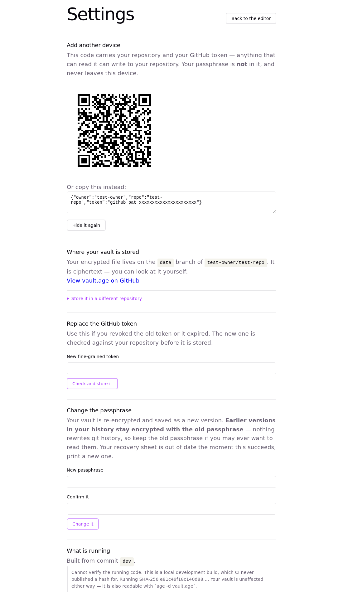

# eigenheim

**One text file. Encrypted in your browser. Stored as ciphertext in a GitHub repository you own.**

eigenheim is a personal encrypted note — a single monospace text file — that you host yourself.
You deploy it once, open your own URL, type a passphrase, and edit your file. Nobody else can
read it: not GitHub, not Vercel, not the people who wrote this.

[](https://vercel.com/new/clone?repository-url=https://github.com/divizend/eigenheim)

---

## What you get

| | |
|---|---|
|  |  |
| **1. It tells you the truth first.** There is no password reset and no recovery key. | **2. One token, scoped to one repository.** The app already knows which repo it was deployed from. |
|  |  |
| **3. A passphrase with a floor.** Six diceware words are offered; your own is accepted if it is strong enough. | **4. A sheet worth printing.** Your passphrase and the exact command to open the file without this app. |
|  |  |
| **5. The whole app.** One monospace file. Typing saves locally; `⌘S`/`Ctrl+S` saves to GitHub. | **6. Settings.** Add a second device by QR, replace the token, change the passphrase, check what code is running. |

---

## How it works

- **Your text is encrypted before it leaves the page.** `vault.age` is an [age](https://age-encryption.org)
  file with a single scrypt passphrase recipient, ASCII-armored. Encryption and decryption happen
  in your browser, in JavaScript, using `@noble` primitives — no WASM, no server, no backend of
  any kind.
- **GitHub stores ciphertext and nothing else.** The vault lives on an orphan `data` branch as one
  armored blob next to a plaintext README explaining what the blob is.
- **Writes cannot silently lose data.** Every save is a fast-forward-only ref update
  (`force: false`). If another device got there first, GitHub refuses the write and you get a
  three-way merge with both versions on screen — nothing is ever discarded unseen.
- **History is git's.** Every save is a commit. Restoring an old version writes a *new* commit;
  nothing is ever rewritten.
- **Offline is normal.** The app is a PWA. Unlocking needs no network at all, editing continues
  offline, and saves queue until you reconnect.

## Your data is readable without this app

This is the promise the whole design is built around, and it is checked by CI on every push
against the real `age` binary:

```
age -d vault.age
```

With your passphrase and that one command, you get your text back — on any machine, with no
browser, no JavaScript, and no cooperation from this project, GitHub or Vercel. The recovery
sheet printed during setup contains both.

## The trust model, including what is *not* protected

**Protected.** Your passphrase never leaves your device, is never stored anywhere, and is never
in the transfer QR. GitHub and Vercel only ever hold ciphertext. A compromised GitHub account
leaks an encrypted file, not your text. The repository is forced private: the app refuses to
write until `GET /repos/{owner}/{repo}` reports `private: true`, because world-readable
ciphertext can be taken away and attacked offline at leisure.

**Not protected, stated plainly.** Vercel serves the JavaScript that does the decryption. If the
host — or your first load — serves you **hostile code**, that code runs in your browser with your
passphrase in it, and no amount of client-side encryption can save you. This is a real limitation,
not a theoretical one, and it is why:

- the service worker **never activates a new build without asking you first**, so a swapped
  bundle cannot take over a page you are already using;
- Settings shows the **SHA-256 of the bundle actually running**, measured at runtime, compared
  against the hash CI published for that commit into this repository — a value the host does not
  control;
- and the escape hatch above exists, so your data outlives any judgement you make about this app.

> **If you deployed with the button, that hash check will say it cannot verify anything — and
> that is worth fixing.** Vercel's GitHub App is not allowed to write workflow files, so the
> repository it creates for you gets every file in this template *except* `.github/workflows/`.
> The job that publishes `build-hash.txt` therefore never runs in your repository, and there is
> nothing for the app to compare the running bundle against. To turn the check on, copy
> `.github/workflows/ci.yml` from this repository into yours and push once. (The `build-hash.txt`
> that came with the clone is this template's, for a different commit, so it is not a substitute.)

Also not protected: anyone with your unlocked device, and anyone who learns your passphrase.
There is no second factor, because there is no server to enforce one against.

**There is no recovery.** No password reset, no recovery key, no support address that can help.
If you forget the passphrase, the data is gone. That is the cost of nobody else being able to
read it.

## Where your vault is stored

By default it is the repository this app was deployed from — it knows its own name, so you are
never asked to type it. **Settings → Where your vault is stored** shows which repository that is,
links straight to the encrypted file on GitHub so you can look at the ciphertext yourself, and
lets you point this device at a different repository. Changing it keeps your passphrase, your
device identity and your token; it only changes where the file lives. It refuses while you have
unsaved text, because that text belongs to the vault you are moving away from.

## Adding a second device

Open **Settings → Add another device** on a device that already works, reveal the transfer code,
and scan or paste it on the new one. The code carries the repository and the GitHub token, so you
do not create a second token — it does **not** carry the passphrase, which you type once on the
new device. That is the only thing that can decrypt anything.

## Running it yourself

```bash
npm ci
npm run dev            # local dev server
npm test               # unit suite: no network, no token, no binaries
npm run test:e2e       # real Chromium against the production build
npm run build
```

Two suites are opt-in because they need something the bare suite must never require:

```bash
EIGENHEIM_IT_TOKEN=...  npm run test:integration   # against a real private GitHub repo
EIGENHEIM_AGE_BIN=...   npm run test:interop       # against the real age binary
```

## License

MIT.
